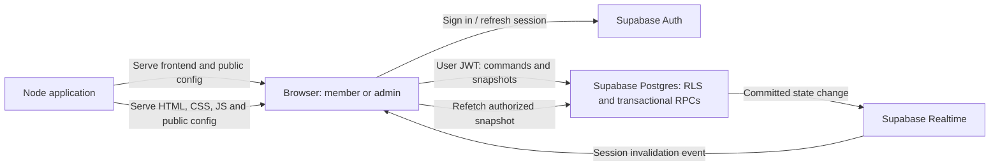

# House bill management — proposed architecture

Status: proposed implementation plan. Supabase schema and initial admin membership
have been applied by the project owner. Connected sign-in and membership lookup are implemented; session/voting persistence remains pending.

## Deployment and responsibility map

One Node deployment serves the frontend and public configuration. The browser calls Supabase directly for Auth and future database RPCs. Supabase supplies Auth,
Postgres, and Realtime. No separate React server, custom WebSocket server, or
message queue is needed for the first version.

## Browser

- Sign-in screen uses Supabase Auth. No public sign-up initially; administrators
  provision accounts and membership separately.
- Auth client maintains and refreshes the user's session. API requests carry the
  current access token. Never log tokens or put them in URLs.
- The database membership determines available screens. Remove the role switcher
  in connected mode; UI visibility is not authorization.
- Member screen shows no session, waiting, or the presented bill. Voting controls
  appear only when that bill's ballot is open.
- Admin screen lists bills and controls session, presentation, and ballots.
- Realtime events trigger a snapshot refresh rather than being trusted as state.
  Subscribe first, fetch after subscription succeeds, refetch on reconnect and
  returning to the tab, and retain a low-frequency polling fallback.
- Show pending/saved/error states for votes. Do not display success before the
  database confirms a write.

## Node

- Serve frontend and public Supabase URL/publishable key.
- Verify the bearer token with Supabase Auth and determine membership from the
  database. Reject absent, invalid, or unapproved users. Never accept a client role.
- Forward the same user's JWT to database queries/RPCs so RLS remains effective.
  A service-role/secret key is unnecessary for ordinary app requests.
- Keep endpoints thin: validate input shape, invoke one database command, map
  errors, return role-filtered state. Put authoritative race-sensitive rules in
  SQL transactions, not duplicated across Node and SQL.
- Continue binding locally while developing. Production needs HTTPS, explicit
  allowed origins, rate limits, and deployment configuration.

## Database model

- house_members: approved Auth user IDs with admin/member role. Assignment stays
  in the dashboard/SQL initially, not in user-controlled profile metadata.
- house_bills: reusable document and lifecycle (draft, ready, passed, failed).
- house_sessions: meeting lifecycle and current_bill_id; at most one active.
- house_ballots: session + bill, separate closed/open/finalized state; one ballot
  per bill per session for v1. Reopening a closed ballot retains its votes.
- house_votes: ballot + member primary key; an upsert changes that member's vote
  without increasing the count. A different session gets a different ballot.

No votes belong directly to bills. Presenting a bill does not open voting.
Moving to another bill closes any open ballot first, preventing invisible voting.
Ending a session closes ballots and clears the presented bill atomically.

## Commands and concurrency

SQL RPCs: start_session, end_session, present_bill, hide_bill, open_ballot,
close_ballot, cast_vote, and (later) finalize_ballot.

Each RPC checks auth.uid() and membership. Admin commands require an admin role.
Cast_vote accepts the ballot ID and choice, derives member ID from auth.uid(),
and verifies an active session, matching presented bill, and open ballot.

Admin transitions and cast_vote acquire locks in the same order: session row,
then ballot row. Recheck conditions after locking. A vote racing with closure is
accepted only if its transaction precedes closure; otherwise it fails. Unique
constraints handle duplicate votes and concurrent attempts to start sessions.
Repeated start/end/present operations should be idempotent where practical.

Use SECURITY DEFINER RPCs only with explicit membership checks, qualified table
names, fixed search_path, and EXECUTE revoked from PUBLIC/anon. Grant only the
required operations to authenticated users; keep raw table writes disabled.

## Read permissions and live updates

Admins can read all bills and aggregate vote totals. Approved members receive
only session presentation state, the current bill, ballot state, and their own
vote. Individual votes are not broadcast to the room.

Use a private Realtime channel for the active workspace. A transaction emits a
minimal state-changed notification containing no bill document or vote choice.
Membership-based Realtime authorization controls subscriptions. On notification,
clients refetch the permitted snapshot. Admin totals refresh through that snapshot;
members cannot retrieve other members' votes.

A notification failure must not lose votes: Postgres is the source of truth.
Subscription failures show reconnecting status and fall back to refetching.

## Decisions before real voting

- Invite-only membership is the initial default. GT SSO is a later integration.
- One workspace and one active meeting initially.
- Votes are changeable until closure, visible by identity only to the voter.
- Quorum, majority threshold, abstention rules, admin voting eligibility, tie
  handling, and result visibility must be agreed before automatic outcomes.
- Do not infer Passed from an admin dropdown. Finalization is a separate audited
  action once the result rules are defined. Add an append-only event log before
  treating this as an official voting record.
- Imports remain inactive placeholders until document handling is scoped.

## Build sequence and verification

1. Auth screen and verified membership; remove connected-mode demo identity.
2. Transactional command RPCs, read snapshot RPC, and permissions migration.
3. Connect Node endpoints to RPCs; stop writing JSON in connected mode.
4. Private Realtime invalidations, reconnect reconciliation, and admin totals.
5. Test two distinct accounts in separate browsers: admin presents, member follows,
   member votes, admin closes; attempt role spoofing, hidden-bill access, duplicate
   votes, concurrent closure, expired login, reconnect, and restart.
6. Deploy Node separately from the old static prototype and configure Auth URLs.

Keep changes on a feature branch and merge through a PR. The currently applied
initial migration is deliberately locked down; do not disable RLS for testing.
